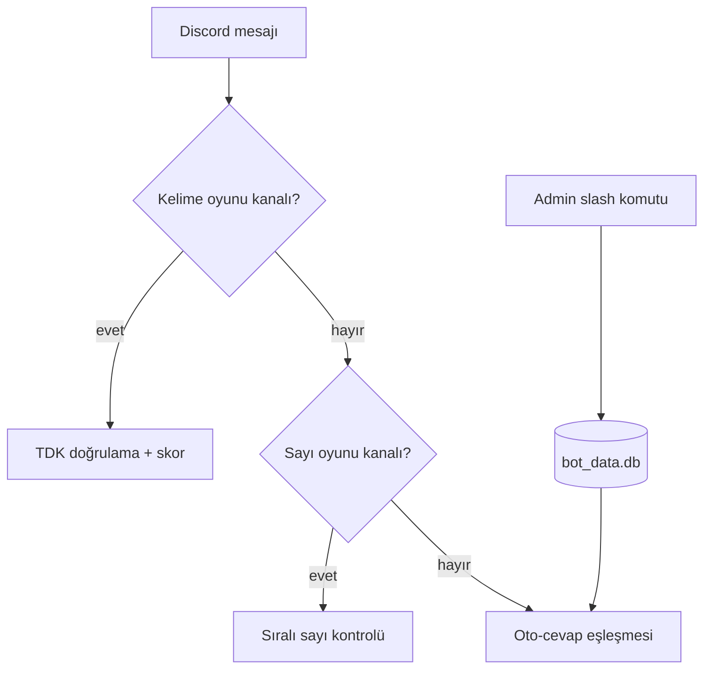

# Vassal of Tiamat

**Tüm özellikleri kodla oynamadan, doğrudan Discord içinden slash komutlarıyla canlı yönetilebilen dinamik Discord botu.**

Karşılama/uğurlama mesajları, oto-cevap ve GIF yönetimi, rol menüleri, kelime/sayı oyunları ve bot durumu Discord'dan değiştirilir; tüm durum yerel SQLite veritabanında (`bot_data.db`) saklanır ve yeniden başlatmalarda korunur.


*TODO: `assets/demo.gif` — slash komutlarıyla canlı yönetimi gösteren kısa kayıt eklenecek.*

## Özet

| | |
|---|---|
| **Problem** | Bot davranışını değiştirmek için her seferinde kod/yeniden dağıtım gerekmesi |
| **Yöntem** | Slash komutları ile çalışma anında yapılandırma; SQLite kalıcılığı (Discord 64-bit ID'leri için) |
| **Simülasyon / donanım** | Python Discord botu; 7/24 barındırma: Discloud / Square Cloud / panel hosting |
| **Makale** | — (yazılım projesi) |

### Sistem mimarisi

`bot.py` (kalıcılık, olaylar, slash komutları, rol menüleri) + `config.py` (varsayılanlar) → `bot_data.db`. Düşük RAM için mesaj/üye cache'i kapalıdır. Komut listesi: [docs/README_ayrintili.md](docs/README_ayrintili.md).

### Akış şeması (nasıl çalışır)



Mesajlar sabit öncelik zincirinden geçer: önce oyunlar, sonra oto-cevap. Slash komutlarıyla yapılan ayarlar SQLite'a yazılır ve yeniden başlatmada korunur.

## Seçilmiş sonuçlar

Yazılım projesidir; ölçülmüş deney sonucu yoktur. Çıktı: çalışan komut seti ve rol menüleri.
*TODO: `plots/` altına rol menüsü ekran görüntüleri eklenecek.*

## Kurulum

### Gereksinimler
- Python 3.10+, bir Discord bot token'ı: `.env` içinde `DISCORD_TOKEN=...` (`.env.example`'a bak; repoya yazılmaz)

### Adımlar
```bash
git clone https://github.com/GulogluHaktan/VassalOfTiamat.git
cd VassalOfTiamat
python3 -m venv .venv && source .venv/bin/activate
pip install -r requirements.txt
```

## Kullanım

```bash
python bot.py
```
Beklenen çıktı: bot giriş yapar, slash komutları sunucuda görünür (`/karsilama_bilgisi`, `/otocevap_listele`, `/durum_ayarla` …).

## Sonuçları yeniden üret

| Çıktı | Komut |
|---|---|
| Bot çalışır durumda | `python bot.py` |

## Proje yapısı

```
VassalOfTiamat/
├── bot.py             # bot ve slash komutları
├── config.py          # yapılandırma
├── requirements.txt
├── Procfile / discloud.config / squarecloud.config   # barındırma ayarları
├── docs/              # ayrıntılı komut listesi ve yayınlama rehberi
└── assets/            # README görselleri
```

## Atıf, lisans, iletişim

```bibtex
@misc{vassaloftiamat2026,
  title  = {Vassal of Tiamat},
  author = {Haktan G{\"u}lo{\u{g}}lu},
  year   = {2026},
  url    = {https://github.com/GulogluHaktan/VassalOfTiamat}
}
```
Lisans: TODO. İletişim: Haktan Güloğlu.
