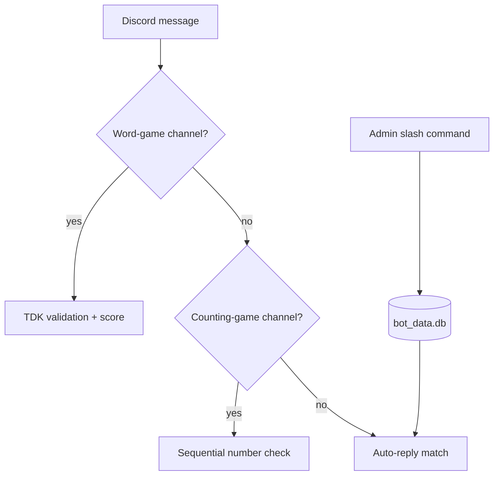

🇬🇧 English · 🇹🇷 [Türkçe](README.tr.md)

# Vassal of Tiamat

**A dynamic Discord bot whose every feature can be managed live from inside Discord with slash commands, without touching code.**

Welcome/farewell messages, auto-reply and GIF management, role menus, word/counting games and bot status are changed from Discord; all state is kept in a local SQLite database (`bot_data.db`) and survives restarts.


*TODO: add `assets/demo.gif` — short recording of live management via slash commands.*

## Summary

| | |
|---|---|
| **Problem** | Needing a code change/redeploy every time the bot's behaviour changes |
| **Method** | Runtime configuration via slash commands; SQLite persistence (for Discord 64-bit IDs) |
| **Simulation / hardware** | Python Discord bot; 24/7 hosting: Discloud / Square Cloud / panel hosting |
| **Paper** | — (software project) |

### System architecture

`bot.py` (persistence, events, slash commands, role menus) + `config.py` (defaults) → `bot_data.db`. Message/member caches are disabled to save RAM. Command list: [docs/README_ayrintili.md](docs/README_ayrintili.md) (Turkish).

### Flow diagram (how it works)



Messages pass through a fixed priority chain: games first, then auto-reply. Settings changed with slash commands are written to SQLite and persist across restarts.

## Selected results

This is a software project; there are no measured experiment results. Output: a working command set and role menus.
*TODO: add role-menu screenshots under `plots/`.*

## Installation

### Requirements
- Python 3.10+, a Discord bot token in `.env` as `DISCORD_TOKEN=...` (see `.env.example`; never committed)

### Steps
```bash
git clone https://github.com/GulogluHaktan/VassalOfTiamat.git
cd VassalOfTiamat
python3 -m venv .venv && source .venv/bin/activate
pip install -r requirements.txt
```

## Usage

```bash
python bot.py
```
Expected output: the bot logs in and the slash commands appear on the server (`/karsilama_bilgisi`, `/otocevap_listele`, `/durum_ayarla` …).

## Reproducing the results

| Output | Command |
|---|---|
| Bot running | `python bot.py` |

## Project structure

```
VassalOfTiamat/
├── bot.py             # bot and slash commands
├── config.py          # configuration defaults
├── requirements.txt
├── Procfile / discloud.config / squarecloud.config   # hosting settings
├── docs/              # detailed command list and hosting guide
└── assets/            # README images
```

## Citation, license, contact

```bibtex
@misc{vassaloftiamat2026,
  title  = {Vassal of Tiamat},
  author = {Haktan G{\"u}lo{\u{g}}lu},
  year   = {2026},
  url    = {https://github.com/GulogluHaktan/VassalOfTiamat}
}
```
License: TODO. Contact: Haktan Güloğlu.
